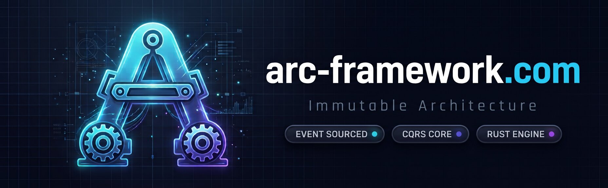

<p align="center">
  
</p>

<p align="center">
  <a href="https://github.com/firebrikdotcom/arc/actions/workflows/ci.yml?query=branch%3Amaster"></a>
  <a href="https://github.com/firebrikdotcom/arc/actions/workflows/security.yml?query=branch%3Amaster"></a>
  <a href="https://github.com/firebrikdotcom/arc/actions/workflows/ci.yml?query=branch%3Amaster"></a>
  <a href="https://crates.io/crates/arc-web-cli"></a>
  <a href="LICENSE-MIT"></a>
</p>

<p align="center">
  <a href="https://arc-framework.com"><strong>Website</strong></a>
  &nbsp; · &nbsp;
  <a href="https://firebrikdotcom.github.io/arc/"><strong>Documentation</strong></a>
  &nbsp; · &nbsp;
  <a href="https://github.com/firebrikdotcom/arc/releases">Releases</a>
</p>

Arc is a beta Rust framework for event-sourced applications with separate web
and native UI adapters. Web UIs are for web deployments; Android uses the FFI
adapter.

It uses Actix Web, Tera, SQLite or Postgres, NATS JetStream, and Benthos. Browser routes use cookie sessions; API routes use JWT bearer authentication.

## Quality checks

The [CI workflow](https://github.com/firebrikdotcom/arc/actions/workflows/ci.yml) and
[Security workflow](https://github.com/firebrikdotcom/arc/actions/workflows/security.yml)
run these checks:

- Debug/release builds on Linux, macOS and Windows with stable and nightly Rust; tests on Linux with stable Rust.
- Formatting and Clippy with warnings denied.
- Browser authentication, CRUD, bounded-collection and durable-audit regressions.
- Rust and npm dependency audits, secrets scanning, CodeQL and Semgrep.
- Coverage generation, documentation checks and frontend builds.

The coverage badge links to CI's Code Coverage job; it does not claim a minimum
coverage percentage. Codecov uploads are best-effort. Version and license badges
show package metadata, not quality certification. Arc is licensed under
[MIT](LICENSE-MIT) or [Apache-2.0](LICENSE-APACHE).

## Start a new application

For a native Android project, see [Your first Android app](docs/android.md).
The guide documents the verified CLI, toolchain requirements, emulator flow,
and safe in-place deployment.

You do not need to clone this repository. Install the generator and create a minimal application:

```bash
cargo install arc-web-cli
arc new my-app
cd my-app
make setup
make dev
```

Open <http://127.0.0.1:8080/health>.

For a browser UI with Tera views and assets:

```bash
arc new my-app --ui
```

The generated application owns its migrations, `.env.example`, Makefile, routes, and domain skeleton. `make setup` creates `.env` with a random local secret, creates SQLite, and runs migrations. It is safe to run again and does not replace an existing secret.

Generate a complete event-sourced resource from the application root:

```bash
arc generate resource Product --api
make migrate
```

This creates and registers the aggregate, commands, events, projector, read-model migration,
focused tests, and JSON CRUD routes. Existing resources are never overwritten.

Requirements: stable Rust, SQLite development libraries, and `make`.

## Contributing to Arc

Clone this repository only when developing Arc itself:

```bash
cp .env.example .env
make setup
make frontend-build
make serve
```

Run `make deps-check` to verify the repository’s Rust, Node.js, SQLite, and OpenSSL requirements.

## Use another port

Port `8080` must be free. If it is busy, edit `.env`:

```dotenv
APP_PORT=8081
```

Then run `make dev` and open <http://127.0.0.1:8081>.

To find the process using port 8080 on Linux:

```bash
ss -ltnp '( sport = :8080 )'
```

## Generated configuration

The quick start copies safe development defaults from `.env.example`.

The generated `.env.example` includes:

```dotenv
APP_URL=127.0.0.1
APP_PORT=8080
DATABASE_DRIVER=sqlite
DATABASE_URL=database/database.sqlite
SECRET_KEY=generate-me
```

`make setup` replaces `generate-me` with a random 64-byte secret in `.env`. Never commit `.env`.

## Useful commands

```bash
make setup           # Create local config, database, and migrations
make dev             # Run the server
make serve           # Run the server (alias)
make migrate         # Apply database migrations
make test            # Run the full test suite
make check           # Compile without running
```

Run `make help` for the complete command list.

## Architecture

- `arc-core`: aggregates, commands, events, projections, sessions, audit, and integrity primitives
- `arc-stack`: headless event-sourced stack assembly shared by adapters
- `arc-ffi`: async native adapter runtime and shared core registry (UniFFI)
- `arc-es-sqlite`: SQLite event, read-model, snapshot, and session stores
- `arc-es-postgres`: Postgres event, read-model, and snapshot stores
- `arc-es-nats`: NATS JetStream event publisher
- `arc-web`: reusable Actix runtime and framework helpers
- `arc-web-cli`: the published package that installs the `arc new` application and resource generator
- `arc-app`: application-owned domains, routes, templates, validation, and migrations

Benthos is the only durable distributed event router. It consumes `events.>` and delivers to HTTP or NATS handlers; it never writes Arc databases directly.

`arc-stack` owns shared stack assembly. `arc-web` is the web adapter and
`arc-ffi` is the native adapter without web dependencies. This shared-stack
work is a 0.9.0 candidate and has not been published. See
[ADR 0003](docs/architecture-decisions/0003-shared-stack-ui-adapters.md).

## Documentation

- [Canonical Docsify documentation](docs/README.md)
- [Getting started](docs/getting-started.md)
- [Authentication plugins](docs/auth-plugins.md)
- [Project structure](docs/project-structure.md)
- [Testing](docs/testing.md)
- [Event handlers](docs/event-handlers.md)
- [Upgrading](docs/upgrading.md)
- [Publishing crates](docs/publishing-crates.md)

## License

Arc is licensed under either of the MIT license ([LICENSE-MIT](LICENSE-MIT)) or the Apache License, Version 2.0 ([LICENSE-APACHE](LICENSE-APACHE)), at your option. Unless you state otherwise, any contribution you submit for inclusion is dual licensed as above, without any additional terms or conditions.
